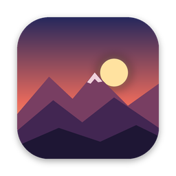
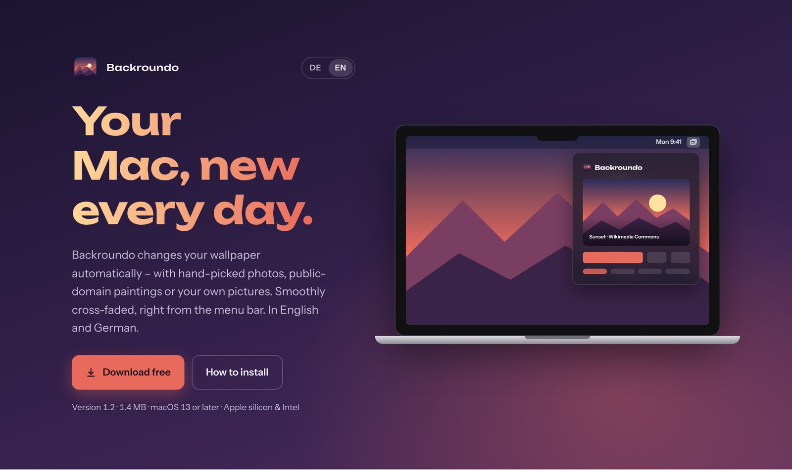

<p align="center">
  
</p>

<h1 align="center">Backroundo</h1>

<p align="center">
  <b>A free macOS menu bar app that gives your Mac a new wallpaper – automatically.</b><br>
  Hand-picked photos from Wikimedia Commons, public-domain paintings from The Met, Unsplash, Pexels, Pixabay, or your own pictures.
</p>

<p align="center">
  <a href="https://badboy1308.github.io/backroundo/downloads/Backroundo-1.4.dmg"><b>⬇ Download Backroundo 1.4 (DMG, 1.6 MB)</b></a>
  &nbsp;·&nbsp;
  <a href="https://badboy1308.github.io/backroundo/en/">Website</a>
  &nbsp;·&nbsp;
  <a href="Manual.pdf">Manual</a>
  &nbsp;·&nbsp;
  <a href="#deutsch">Deutsch</a>
</p>

<p align="center">
  
  
  
  
</p>

<p align="center">
  
</p>

## Features

- **Changes on its own** – every 15 minutes, hourly, daily, or whenever you click *Next Wallpaper*
- **Smooth cross-fade** between the old and the new wallpaper
- **Six image sources** – pick one or mix them:
  - **Wikimedia Commons** “Picture of the Day” from 10+ years of archive – no account needed
  - **The Met** – public-domain landscape and seascape paintings (CC0) – no account needed
  - **Unsplash** – by category or search term (needs your own free key)
  - **Pexels** – more photos with the same search term (needs your own free key; Pexels has paused issuing new keys for now)
  - **Pixabay** – large free photo collection with the same search term (needs your own free key; max. 1280 px with a standard key)
  - **Your own folder** – including subfolders
- **Favorites library** – collect images with one click, set them again later, or rotate only through your favorites
- **Multiple displays**, **open at login**
- **Credits shown** for every image – author, license and source
- **No account, no ads, no tracking** – everything stays on your Mac
- English and German, following your Mac's language

## Install

1. [Download the DMG](https://badboy1308.github.io/backroundo/downloads/Backroundo-1.4.dmg) and open it.
2. Drag **Backroundo** to **Applications**.
3. Launch it – the icon appears in the menu bar.

Backroundo is not notarized by Apple yet, so macOS blocks the first launch. Open **System Settings → Privacy & Security** and click **Open Anyway** – or run once:

```sh
xattr -dr com.apple.quarantine /Applications/Backroundo.app
```

Full instructions: [Manual (PDF)](Manual.pdf)

## License

Backroundo is **freeware** © 2026 Marco Schulz – free to use and to share unchanged. See [License.txt](License.txt) (English translation) and [Lizenz.txt](Lizenz.txt) (binding German version).
Not affiliated with Unsplash, Pexels, Pixabay, Wikimedia, The Metropolitan Museum of Art or Apple.

Feedback and ideas are welcome – open an [issue](../../issues) or write to marco.sa.schulz@googlemail.com. If you like Backroundo, a ⭐ helps others find it.

---

<a id="deutsch"></a>

## Deutsch

**Backroundo** ist eine kostenlose Mac-App für die Menüleiste, die dein Hintergrundbild automatisch wechselt – mit Fotos von Wikimedia Commons, gemeinfreien Gemälden aus dem Metropolitan Museum, Unsplash, Pexels, Pixabay oder deinen eigenen Bildern. Weich überblendet, ohne Konto, ohne Werbung, ohne Tracking.

- [**Backroundo 1.4 laden** (DMG, 1,6 MB)](https://badboy1308.github.io/backroundo/downloads/Backroundo-1.4.dmg) · macOS 13 oder neuer · Apple-Chip & Intel
- [Webseite](https://badboy1308.github.io/backroundo/) · [Anleitung (PDF)](Anleitung.pdf) · [Lizenz](Lizenz.txt)
